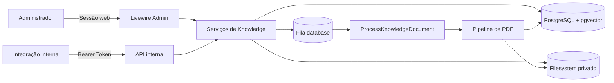

# Visão geral, requisitos e arquitetura

## Relação com o objetivo do TCC

O projeto acadêmico busca interpretar bulas e identificar potenciais interações medicamentosas com LLM e RAG, apresentando informações em linguagem acessível. A implementação descrita neste documento corresponde à fundação desse objetivo: ingestão, procedência, armazenamento, extração e preparação rastreável do corpus.

RAG, LLM, base estruturada de interações e interface do usuário final permanecem fora do estado implementado. A relação completa entre proposta e código está em `00-contexto-e-alinhamento-com-o-projeto.md`.

## Caracterização do sistema

O BULA-IA é uma aplicação web para ingestão, organização, rastreabilidade e preparação de documentos farmacêuticos privados. A implementação atual concentra-se na fundação da base de conhecimento: controle de procedência, armazenamento privado de PDFs, extração textual, divisão em fragmentos rastreáveis e revisão administrativa.

O sistema foi estruturado para permitir uma futura solução de Hybrid RAG, mas a etapa atual não implementa embeddings, recuperação vetorial, reranking, orquestração de modelos de linguagem ou geração de respostas.

O escopo acadêmico planejado considera 30 medicamentos selecionados, dados da ANVISA e DrugBank e análise de interações. Esses dados ainda não integram o repositório e dependem de curadoria e licenciamento.

## Atores

| Ator | Responsabilidade |
| --- | --- |
| Administrador | Gerencia origens, documentos, uploads, lotes, pendências e processamento |
| Integração interna | Envia documentos e PDFs pelas APIs protegidas por token |
| Worker de fila | Executa o processamento assíncrono dos documentos |
| Usuário comum | Possui perfil previsto no modelo, mas não acessa o módulo administrativo |

## Requisitos funcionais implementados

- RF01 — autenticar administradores por sessão;
- RF02 — restringir o módulo administrativo ao perfil `ADMIN`;
- RF03 — cadastrar, editar, consultar, ativar e desativar origens documentais;
- RF04 — cadastrar e consultar documentos lógicos independentemente do PDF;
- RF05 — importar metadados e chunks estruturados pela API interna;
- RF06 — anexar um PDF a um documento explícito;
- RF07 — receber múltiplos PDFs em um lote e tratar cada item isoladamente;
- RF08 — detectar duplicidades por SHA-256;
- RF09 — manter arquivos sem associação segura em quarentena privada;
- RF10 — associar manualmente uma pendência a documento novo ou existente;
- RF11 — extrair texto de PDFs, detectar seções e criar chunks rastreáveis;
- RF12 — reprocessar um documento sem perder chunks válidos em caso de falha;
- RF13 — apresentar painel, catálogos, estados e erros controlados no Admin;
- RF14 — manter procedência entre origem, lote, documento e chunks.

## Requisitos não funcionais observáveis

- RNF01 — segurança: arquivos não são publicados diretamente e rotas possuem autenticação;
- RNF02 — integridade: SHA-256 identifica os bytes e auxilia a detectar alterações e duplicidades;
- RNF03 — rastreabilidade: chunks mantêm documento, seção e intervalo de páginas;
- RNF04 — consistência: transações e bloqueios pessimistas evitam sobrescrita concorrente;
- RNF05 — portabilidade: acesso aos objetos ocorre pela abstração Laravel Filesystem;
- RNF06 — manutenibilidade: regras de domínio ficam em serviços, separadas de controllers e componentes;
- RNF07 — testabilidade: fluxos principais e falhas relevantes possuem testes automatizados;
- RNF08 — confidencialidade operacional: respostas não revelam caminhos, SQL ou stack traces;
- RNF09 — usabilidade administrativa: páginas responsivas, pesquisa e paginação no servidor;
- RNF10 — determinismo: normalização, detecção de seções e chunking não dependem de IA generativa.

Requisitos de desempenho, disponibilidade, recuperação de desastre e escalabilidade ainda precisam de metas mensuráveis e experimentos. Não devem ser declarados como atendidos sem evidência.

## Arquitetura

A aplicação é um monólito modular Laravel. Livewire implementa a interface administrativa; controllers atendem a API; serviços concentram o domínio; Eloquent persiste o estado; Laravel Queue executa o processamento; e Laravel Filesystem abstrai o armazenamento privado.

## Tecnologias principais

- PHP 8.4;
- Laravel 13.30.1;
- Livewire 4.4.3;
- PostgreSQL 17;
- extensão pgvector preparada no banco;
- Tailwind CSS 4 e Vite;
- PHPUnit 12;
- `prinsfrank/pdfparser` 3.4.0;
- fila Laravel com driver de banco de dados.

As versões devem ser atualizadas no TCC caso o experimento utilize outro commit ou data. A escolha dessa pilha deve ser apresentada pelos requisitos e decisões do desenvolvimento atual; tecnologias citadas no projeto preliminar não são restrições arquiteturais.

## Decisões arquiteturais relevantes

### Separação entre identidade lógica e arquivo físico

`knowledge_documents` representa o documento lógico; o PDF é um objeto físico referenciado por disco e chave. Essa separação permite cadastrar metadados antes do arquivo, anexar o PDF posteriormente e manter estados independentes.

### Serviços como fronteira de regras

Componentes Livewire e controllers validam a entrada e delegam as operações. Associação, locking, checksum, promoção de arquivo, compensação e processamento permanecem em serviços. Isso reduz duplicação entre interface administrativa e API.

### Processamento assíncrono

Arquivos associados disparam um Job único por documento. O processamento pesado não precisa ocorrer na interação administrativa, embora o recebimento do lote ainda seja síncrono.

### Pipeline determinístico antes de RAG

A preparação textual foi implementada antes da busca semântica. Isso prioriza qualidade, procedência e capacidade de auditoria dos dados que alimentarão etapas futuras.

## Escopo não implementado

- uso de embeddings e busca vetorial (a camada de provedores de IA existe, mas está preparada e sem uso);
- recuperação híbrida e reranking;
- geração de respostas por LLM;
- avaliação clínica das respostas;
- gestão de usuários pela interface;
- alta disponibilidade ou implantação multirregional.
