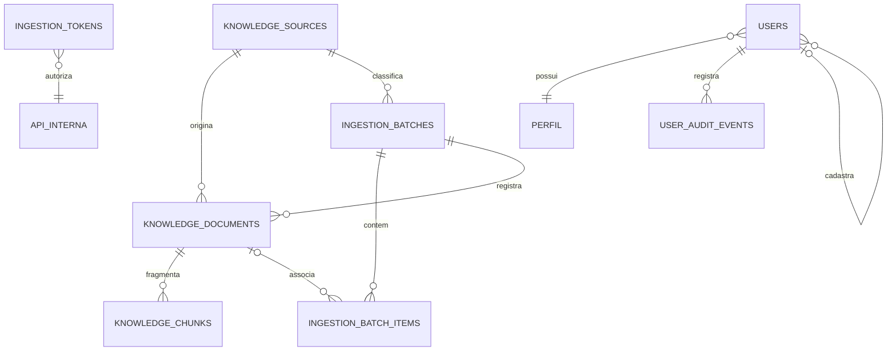

# Modelagem de dados e integridade

## Modelo conceitual

O domínio distingue procedência, identidade documental, arquivo físico, conteúdo fragmentado e operação de ingestão. Essa distinção é importante para auditoria: uma origem não é um documento, e documentos com metadados semelhantes não são necessariamente o mesmo arquivo.



## Entidades principais

### `knowledge_sources`

Registra a procedência do conteúdo. Contém nome, coleção, organização, tipo, país, URL, descrição, prioridade e estado ativo. Campos normalizados sustentam unicidade sem diferença de caixa entre nome e coleção.

### `knowledge_documents`

Representa um documento lógico. Mantém origem, lote, chaves externas, título, tipo, idioma, identidade do arquivo, SHA-256, metadados e estados de arquivo, conteúdo e embedding.

O modelo atual permite um PDF ativo por documento e não mantém histórico de versões do arquivo.

### `knowledge_chunks`

Armazena fragmentos ordenados do documento. Cada linha contém índice, seção, página inicial, página final, conteúdo, metadados e campos reservados para tokenização e embedding.

### `ingestion_batches`

Representa uma operação de carga. Registra origem, estado e contadores persistidos de itens associados, duplicados, pendentes e com erro.

### `ingestion_batch_items`

Registra o resultado individual de cada arquivo enviado. Mantém nome, SHA-256, MIME, tamanho, possível documento associado, forma de resolução, motivo e referência privada de armazenamento.

### `ingestion_tokens`

Autoriza integrações internas. Persiste nome, hash do token, escopo, expiração, último uso e revogação. O segredo em texto puro não é armazenado.

### `users`

Usa o guard de sessão do Laravel e o papel `ADMIN` ou `USER` para autorização administrativa. O e-mail é gravado em minúsculas (único). O estado da conta fica em `active` (acesso permitido), `must_change_password` (senha provisória pendente de troca), `created_by` (quem cadastrou) e `last_login_at` (último acesso). Desativar não apaga o registro, o que preserva a autoria e o histórico.

### `user_audit_events`

Trilha de auditoria da gestão de usuários, somente de inclusão: pessoa afetada, autor da ação, evento (`created`, `updated`, `role_changed`, `deactivated`, `reactivated`, `temporary_password_issued`, `password_changed`), detalhes em JSON (campos alterados, perfil de/para, origem da troca de senha — `via: first_access` quando feita na tela de primeiro acesso), IP e data. Nunca contém senha ou hash.

## Estados do domínio

O documento possui três estados independentes:

- `file_status`: disponibilidade do arquivo;
- `content_status`: situação da extração e dos chunks;
- `embedding_status`: situação futura da representação vetorial.

Valores previstos: `PENDING`, `PROCESSING`, `READY` e `FAILED`. A independência evita concluir, por exemplo, que um PDF armazenado já possui conteúdo processado ou embedding.

Itens de lote utilizam:

| Estado | Significado | Retenção do novo arquivo |
| --- | --- | --- |
| `ASSOCIATED` | PDF vinculado ao documento | Destino definitivo |
| `DUPLICATE` | Bytes já armazenados | Nova cópia descartada |
| `PENDING` | Associação não pôde ser comprovada | Quarentena privada |
| `ERROR` | Falha controlada no item | Arquivo não retido |

## Regras de identidade

- `external_key` identifica um documento no contexto da aplicação e é usada em importações idempotentes;
- `source_document_id` representa o identificador fornecido pela origem e só é resolvido dentro dessa origem;
- SHA-256 identifica exatamente os mesmos bytes, não versões lógicas equivalentes;
- o nome normalizado é um indício de associação, não prova absoluta;
- ambiguidades permanecem pendentes para decisão humana;
- filename e checksum isolados não autorizam criação automática de documento lógico.

## Consistência e concorrência

Operações críticas usam transações do banco e `SELECT ... FOR UPDATE` por meio de `lockForUpdate()`. Antes de anexar ou promover um arquivo, o estado atual do documento e do item é recarregado sob bloqueio. Isso impede que duas requisições concorrentes sobrescrevam silenciosamente o mesmo documento.

Banco e filesystem não participam de uma transação distribuída. O sistema reduz o risco usando chaves UUID pertencentes à operação, staging, verificação de checksum e exclusão compensatória. Uma interrupção abrupta no limite entre gravação e commit ainda pode deixar resíduo.

## Rastreabilidade

A cadeia de procedência disponível é:

```text
origem -> lote -> item -> documento -> chunk -> seção/páginas
```

O vínculo permite investigar de onde veio um fragmento e qual arquivo foi processado. Para uso farmacêutico futuro, essa rastreabilidade é pré-requisito técnico, mas não substitui governança de conteúdo, validação especializada ou responsabilidade clínica.

## Pontos para representar no TCC

- diagrama entidade-relacionamento gerado a partir das migrations;
- justificativa da separação entre origem, documento e arquivo;
- cardinalidades e restrições de unicidade;
- máquina de estados de documento e item de lote;
- estratégia de integridade referencial e concorrência;
- limitações: um arquivo ativo por documento e ausência de versionamento documental.
