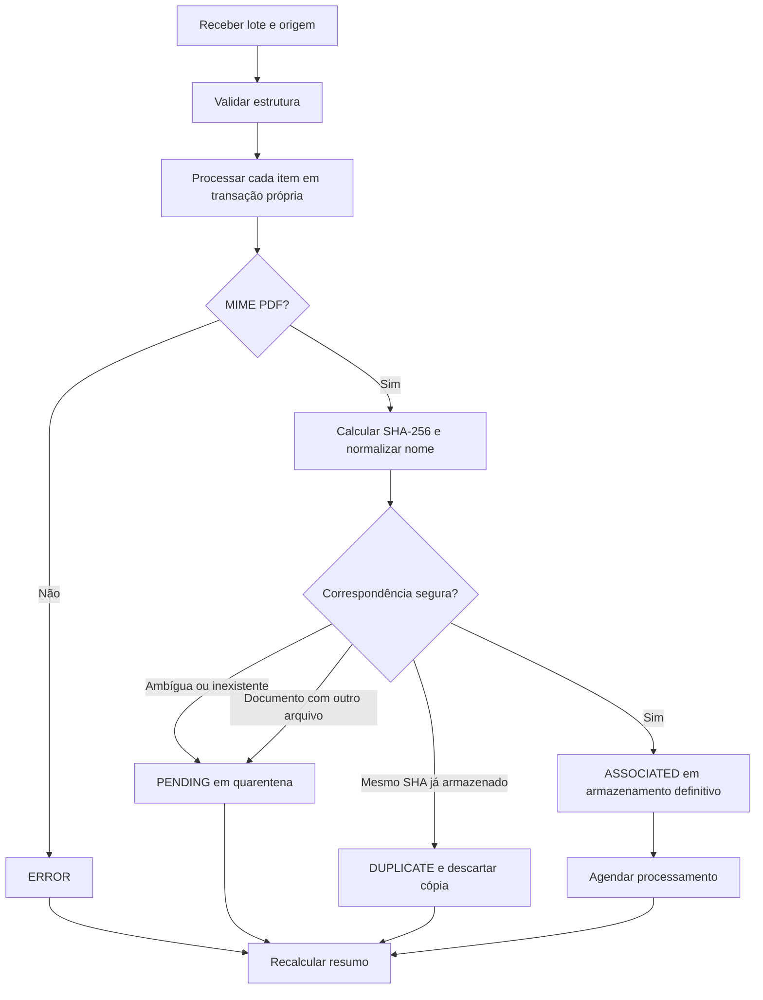

# Ingestão e processamento de documentos

## Canais de entrada

O sistema possui três caminhos de entrada que compartilham serviços de domínio:

1. interface administrativa para upload de múltiplos PDFs;
2. API interna para importação estruturada ou multipart;
3. cadastro manual de documento lógico pelo administrador.

Essa convergência evita implementar regras diferentes para a interface e a API.

## Fluxo de ingestão em lote



### Ordem de resolução

1. chave externa explícita;
2. SHA-256 conhecido;
3. identificador documental dentro da origem do lote;
4. filename normalizado;
5. criação automática, somente com origem ativa, identificador estruturado, título e tipo documental.

Quando há mais de um candidato, o sistema não escolhe arbitrariamente. O arquivo permanece `PENDING` e pode ser revisado pelo administrador.

## Associação manual

A associação de uma pendência reaproveita o objeto já armazenado; não exige novo upload. Dentro de transação, o serviço:

1. bloqueia e relê o item;
2. confirma que ele ainda está pendente;
3. verifica existência e SHA-256 do objeto em quarentena;
4. bloqueia e relê o documento escolhido;
5. reavalia duplicidade e ocupação;
6. copia e verifica o objeto em staging;
7. promove para uma chave definitiva com UUID;
8. atualiza item, documento e contadores;
9. remove a quarentena após commit;
10. agenda processamento quando necessário.

Repetições são idempotentes: um item já resolvido não é processado novamente.

## Pipeline de conteúdo


### Extração

`PdfTextExtractor` é uma interface da aplicação. A implementação atual usa `prinsfrank/pdfparser`, recebe uma cópia local temporária e devolve objetos próprios com páginas numeradas a partir de 1. O arquivo temporário é removido em bloco `finally`.

### Normalização

A normalização padroniza quebras de linha, remove caracteres de controle, reduz espaços horizontais e excesso de linhas vazias. Ela evita modificar unidades, doses, percentuais, vírgulas decimais, nomes ou conteúdo clínico.

### Detecção de seções

O detector reconhece uma lista conservadora de títulos comuns em bulas e também cabeçalhos curtos em maiúsculas. Texto sem evidência de título permanece sem seção, evitando classificação inventada.

### Chunking

Blocos são acumulados até o tamanho-alvo e divididos em limites de sentença ou espaço quando possível. O overlap ocorre apenas entre chunks consecutivos da mesma seção. Os chunks não cruzam documentos nem seções e preservam a faixa de páginas.

Parâmetros atuais em `config/knowledge.php`:

- PDF de até 25 MiB para processamento;
- até 500 páginas;
- até 5.000.000 de caracteres normalizados;
- mínimo de 20 caracteres úteis;
- alvo de 1.800 caracteres por chunk;
- máximo de 2.600 caracteres;
- overlap de 200 caracteres;
- timeout do Job de 60 segundos.

Esses valores são escolhas iniciais de engenharia. O TCC deve distingui-los de parâmetros cientificamente otimizados e, se relevante, avaliá-los experimentalmente.

## Atomicidade do reprocessamento

Extração e montagem dos novos chunks terminam antes da exclusão dos anteriores. A substituição final ocorre em transação e valida novamente a identidade do arquivo. Assim, falhas de parser ou chunking preservam o último conjunto válido; um sucesso substitui o conjunto inteiro sem duplicação.

## Estados e erros

O conteúdo percorre `PENDING -> PROCESSING -> READY` ou `FAILED`. Erros controlados incluem falha de extração de texto e falha genérica de processamento. Informações técnicas ficam nos logs associadas a um `error_id`, enquanto a interface exibe apenas código e referência.

## Operação

```bash
php artisan knowledge:process-document 123
php artisan knowledge:process-document 123 --force
php artisan knowledge:process-document 123 --force --sync
php artisan queue:work database --queue=default --timeout=60
```

O modo padrão agenda o Job; `--sync` é indicado para diagnóstico controlado. O Job é único por documento durante dez minutos e o processador ignora documentos `READY` quando não há solicitação de força.

## Aspectos para discussão acadêmica

- impacto da qualidade da extração na recuperação futura;
- escolha entre chunking estrutural e divisão puramente posicional;
- importância de páginas e seções para explicabilidade;
- human-in-the-loop na resolução de ambiguidades;
- idempotência, concorrência e compensação em sistemas com banco e object storage;
- diferença entre preparação do corpus e uma solução RAG completa.
