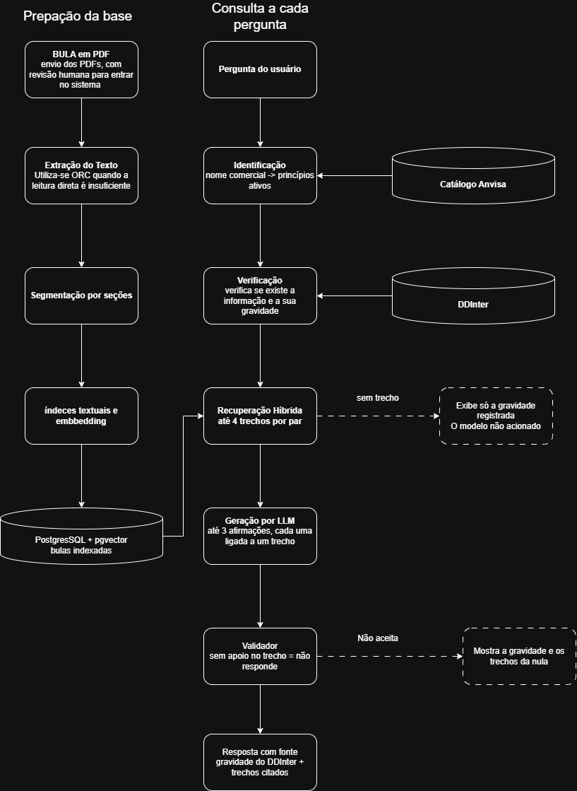
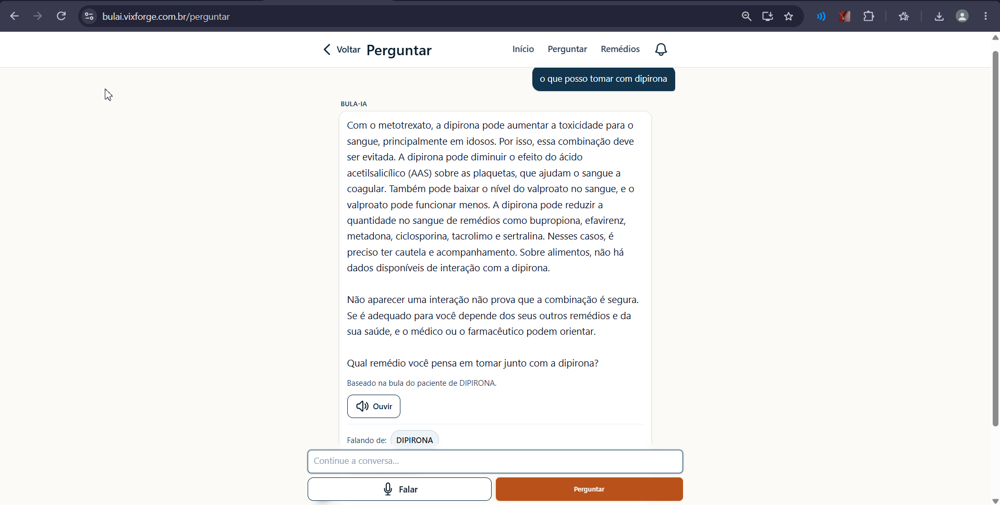
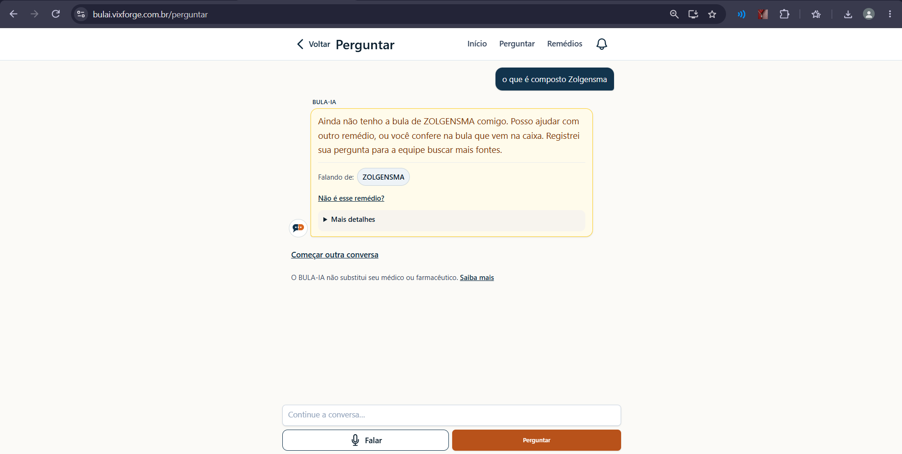

# BULA-IA: SISTEMA INTELIGENTE PARA ANÁLISE DE INTERAÇÕES MEDICAMENTOSAS

# BULA-IA: AN INTELLIGENT SYSTEM FOR DRUG INTERACTION ANALYSIS

DAVI TÂMBARA RODRIGUES

Graduando em Sistemas de Informação

tambaradavi@gmail.com

WILTON CARVALHO DE OLIVEIRA

Graduando em Sistemas de Informação

woliveiravix@gmail.com

HOWARD CRUZ ROATTI

Prof.º Msc. Centro Universitário FAESA

howard.cruz@faesa.br

**RESUMO**

As bulas usam linguagem técnica de difícil compreensão, e a polifarmácia amplia o risco de interações medicamentosas. Este trabalho desenvolveu e avaliou o BULA-IA, aplicação web que usa modelos de linguagem de grande escala (LLMs) e geração aumentada por recuperação (RAG) sobre as bulas da Agência Nacional de Vigilância Sanitária e a base de interações DDInter, para explicá-las em linguagem acessível. A base estruturada decide a existência e a gravidade da interação; a recuperação, com busca lexical, vetorial e híbrida em PostgreSQL, localiza os trechos de bula; e o modelo apenas os explica, sob um validador de fundamentação. Todas as medições vêm do servidor de produção, com 91 bulas e 6.699 trechos. O sistema acertou os princípios ativos em 93,6% das consultas reservadas. Nos 1.483 pares, a primeira medição deixou sem alerta 7 interações graves, por princípios ativos duplicados; após a correção, a verificação encontrou as 1.424 interações registradas, sem falso positivo e com a gravidade da base. Em 369 consultas, a busca híbrida trouxe um trecho da seção certa entre os três primeiros em 40,1%, contra 20,6% da lexical e 36,0% da vetorial. Em 234 perguntas livres, o validador aceitou 55,6% das afirmações propostas, e as respostas foram mais fáceis de ler que as bulas em 98,0% dos casos. Sem recuperação, o modelo deixou de reconhecer 50 de 114 interações registradas, sem indicar fontes. Como o gabarito provém da própria base consultada e não houve validação profissional, a avaliação não mede a correção clínica.

**Palavras-chave:** Bulas de medicamentos. Interações medicamentosas. Modelos de linguagem de grande escala. Geração aumentada por recuperação.

***ABSTRACT***

Package inserts use technical language that is hard for patients to understand, and polypharmacy increases the risk of drug interactions. This study developed and evaluated BULA-IA, a web application that uses large language models (LLMs) and retrieval-augmented generation (RAG) over the package inserts of the Brazilian Health Regulatory Agency and the DDInter drug interaction database, to explain them in plain language. The structured database determines whether an interaction exists and its severity; retrieval, with lexical, vector, and hybrid search in PostgreSQL, finds the passages; and the model only explains them, under a grounding validator. All measurements come from the production server, with 91 package inserts and 6,699 passages. The system identified the correct active ingredients in 93.6% of held-out queries. Across 1,483 pairs, the first measurement left 7 major interactions without an alert, because of duplicated active ingredients; after the fix, the check found all 1,424 recorded interactions, with no false positives and with the database severity. In 369 queries, hybrid search ranked a passage from the right section in the top three for 40.1%, against 20.6% for lexical and 36.0% for vector search. In 234 free-text questions, the validator accepted 55.6% of the claims proposed, and answers were easier to read than the package inserts in 98.0% of cases. Without retrieval, the model missed 50 of 114 recorded interactions, without citing sources. Since the reference standard is the database the system queries and there was no validation by health professionals, the evaluation does not measure clinical correctness.

***Keywords:*** *Package inserts. Drug interactions. Large language models. Retrieval-augmented generation.*

## INTRODUÇÃO

Os danos relacionados a medicamentos estão entre as principais causas evitáveis de morbimortalidade nos sistemas de saúde. Ao lançar seu terceiro Desafio Global de Segurança do Paciente, a Organização Mundial da Saúde (OMS) apontou a polifarmácia como um dos três domínios prioritários de ação, ao lado das transições de cuidado e das situações de alto risco, e estimou em cerca de US$ 42 bilhões por ano o custo global associado aos erros de medicação (World Health Organization, 2017).

Nesse contexto, a bula é a principal fonte de informação do paciente sobre o medicamento que ele utiliza, mas sua compreensão integral ainda é uma barreira. Segundo Fujita, Machado e Teixeira (2014), a bula reúne informação técnico-científica complexa, cuja leitura pode não ser uma tarefa fácil para pacientes, geralmente leigos. Silva *et al.* (2006) acrescentam que a linguagem muito científica, a quantidade excessiva de informações e o tamanho reduzido das letras dificultam a compreensão, o que aumenta as chances de uso inadequado dos medicamentos.

Os Modelos de Linguagem de Grande Escala (LLMs) apresentam potencial para reescrever esse conteúdo em linguagem acessível. Contudo, quando utilizados isoladamente, podem produzir informações sem respaldo nas fontes, fenômeno conhecido como alucinação (Huang *et al.*, 2023), o que é crítico no domínio da saúde. A Geração Aumentada por Recuperação (RAG) busca reduzir esse risco ao condicionar a resposta do modelo a trechos recuperados de documentos previamente selecionados (Lewis *et al.*, 2020).

Diante desse cenário, formulou-se o seguinte problema de pesquisa: como os LLMs, apoiados por recuperação de fontes oficiais, podem facilitar a compreensão das bulas e apoiar a identificação de interações medicamentosas de forma rastreável? Partiu-se da hipótese de que ancorar as respostas do modelo em bulas oficiais e em uma base estruturada de interações produziria respostas mais fundamentadas e uma detecção de interações mais confiável do que a obtida com o modelo de linguagem usado isoladamente.

O objetivo geral deste trabalho foi desenvolver e avaliar o BULA-IA, uma aplicação web progressiva baseada em LLMs e RAG, capaz de interpretar bulas de medicamentos e identificar potenciais interações medicamentosas, apresentando os resultados em linguagem acessível. Especificamente, buscou-se:

a) reunir e organizar as bulas do Bulário Eletrônico da Agência Nacional de Vigilância Sanitária (ANVISA) e a base de interações DDInter;

b) indexar as bulas em PostgreSQL com pgvector, com busca lexical, vetorial e híbrida;

c) integrar a recuperação a um LLM com instruções que exigissem a citação das fontes e a recomendação de consulta a um profissional de saúde;

d) implementar a verificação de interações a partir da base DDInter, com a classificação de gravidade;

e) avaliar o sistema quanto à detecção de interações, à relevância dos trechos recuperados e à fundamentação das respostas, em comparação com um modelo de linguagem sem recuperação.

A pesquisa se justifica pela necessidade de democratizar o acesso às informações sobre medicamentos de forma clara, acessível e segura, uma vez que a dificuldade de compreensão das bulas pode contribuir para erros de administração, automedicação inadequada e interações perigosas. O BULA-IA não se propôs a substituir as bases farmacológicas existentes, e sim a investigar uma arquitetura baseada em RAG como camada de acesso a fontes previamente selecionadas. A contribuição está, portanto, na forma de recuperação e apresentação das informações ao usuário, e não na criação de uma nova base farmacológica. Por se tratar de um protótipo acadêmico, a avaliação restringiu-se à viabilidade técnica: as respostas não foram revisadas por profissional de saúde, de modo que os resultados não atestam a correção clínica das informações apresentadas.

**FUNDAMENTAÇÃO TEÓRICA**

Esta seção apresenta os fundamentos que sustentam o trabalho: a bula como fonte de informações sobre medicamentos, a polifarmácia e as interações medicamentosas, as bases de dados farmacológicas, os modelos de linguagem e a geração aumentada por recuperação, os riscos desses modelos na saúde, as estratégias de recuperação e as ferramentas relacionadas.

A bula é o documento que acompanha o medicamento e reúne as informações necessárias ao seu uso seguro, como composição, indicações, contraindicações, posologia, reações adversas e modo de administração. No Brasil, a ANVISA regula a elaboração, a atualização, a publicação e a disponibilização das bulas por meio da Resolução da Diretoria Colegiada (RDC) nº 47/2009, que estabelece versões distintas para pacientes e para profissionais de saúde (Brasil, 2009).

A bula destinada ao paciente começa pela identificação do produto, como nome comercial, princípio ativo, forma farmacêutica, via de administração e faixa etária de uso, e organiza o conteúdo em seções em forma de perguntas e respostas, encerrando com os dados da empresa e a identificação do farmacêutico responsável (Brasil, 2009). Essa padronização em seções é relevante para o processamento automatizado, pois permite localizar o trecho que responde a cada tipo de dúvida.

Além da bula impressa, a ANVISA prevê a bula em formato especial, destinada a pessoas com deficiência visual, em áudio, braile ou fonte ampliada (Agência Nacional de Vigilância Sanitária, 2020b), e, desde 2024, um projeto-piloto de bula digital, acessada por QR Code na embalagem (Brasil, 2024). O Bulário Eletrônico, por sua vez, oferece acesso gratuito às bulas de medicamentos (Agência Nacional de Vigilância Sanitária, 2020a). Essas iniciativas mostram que o próprio órgão regulador reconhece a acessibilidade como um problema; no entanto, ao reproduzirem o mesmo texto técnico em outro suporte, atuam sobre a forma de acesso, e não sobre a dificuldade de compreensão do conteúdo discutida na Introdução. A disponibilidade digital das bulas, por outro lado, viabiliza seu processamento computacional, que é o ponto de partida deste trabalho.

A polifarmácia corresponde ao uso concomitante de múltiplos medicamentos e, embora não haja uma definição única, é frequentemente caracterizada pelo uso rotineiro de cinco ou mais fármacos (World Health Organization, 2019). Sua prevalência cresce com o envelhecimento populacional e com o aumento de doenças crônicas não transmissíveis, que demandam tratamentos prolongados e combinados. O uso simultâneo de vários medicamentos amplia o risco de interações, reações adversas, erros de medicação e baixa adesão ao tratamento, sobretudo em idosos (World Health Organization, 2019).

Segundo Katzung e Trevor (2017), interações medicamentosas ocorrem quando os efeitos de um medicamento são alterados pela presença de outro fármaco, de um alimento ou de outra substância química, o que pode reduzir a eficácia terapêutica ou potencializar os efeitos tóxicos, levando a intoxicações, internações hospitalares e, nos casos mais graves, ao óbito. Quanto à natureza, as interações classificam-se em medicamento-medicamento, medicamento-alimento, medicamento-álcool e medicamento-condição clínica (Brunton; Hilal-Dandan; Knollmann, 2018; Katzung; Trevor, 2017). Este trabalho tratou apenas das interações medicamento-medicamento, uma vez que as demais dependem de informações sobre a dieta, os hábitos e as condições clínicas do paciente, que estão fora do escopo da base de interações utilizada. As interações medicamento-medicamento podem ocorrer antes da administração, como nas incompatibilidades físico-químicas em seringas ou soluções intravenosas, ou após ela, por mecanismos farmacocinéticos ou farmacodinâmicos. As interações farmacocinéticas ocorrem quando um fármaco interfere na absorção, na distribuição, na metabolização ou na excreção de outro, alterando sua concentração no organismo e, com isso, sua eficácia ou toxicidade. As farmacodinâmicas ocorrem quando dois ou mais fármacos potencializam ou reduzem os efeitos um do outro ao atuar sobre os mesmos receptores, sistemas fisiológicos ou mecanismos celulares (Katzung; Trevor, 2017).

Além da natureza, as interações são estratificadas por gravidade, informação essencial tanto para a decisão clínica quanto para sistemas automatizados de apoio. Na escala mais usual, de três níveis, a interação leve produz alterações mínimas no efeito terapêutico, sem exigir mudança de conduta; a moderada pode deteriorar o estado do paciente ou exigir ajuste de dose e monitoramento; e a grave pode provocar complicações potencialmente fatais ou dano permanente, exigindo intervenção imediata e, muitas vezes, a contraindicação da associação (Brunton; Hilal-Dandan; Knollmann, 2018). A detecção e a prevenção desses eventos inserem-se no campo da farmacovigilância, definida como a ciência e as atividades relativas à detecção, à avaliação, à compreensão e à prevenção de efeitos adversos ou de qualquer outro problema relacionado a medicamentos (World Health Organization, 2002).

Bases de dados farmacológicas são sistemas estruturados que armazenam e disponibilizam informações sobre medicamentos, como princípios ativos, mecanismos de ação, contraindicações, efeitos adversos e interações, e que apoiam a decisão clínica ao oferecer acesso rápido a informações confiáveis. Entre as mais citadas na literatura está o DrugBank, que reúne dados químicos, farmacológicos e terapêuticos sobre fármacos e permite a análise estruturada de interações, alvos e mecanismos de ação, com relevância reconhecida em pesquisas biomédicas e na farmacologia clínica (Knox *et al.*, 2024).

O DDInter é uma base de dados online dedicada especificamente às interações medicamento-medicamento, construída com o objetivo de apoiar a decisão clínica e a segurança do paciente (Xiong *et al.*, 2022). Cada par de fármacos é registrado com um nível de gravidade, o que permite consultar diretamente a existência e a gravidade de uma interação. Por disponibilizar esses dados para fins acadêmicos e trazer a gravidade de forma estruturada, o DDInter foi a base de interações adotada neste trabalho, como se detalha na Metodologia. As bases e ferramentas da área, contudo, não adotam uma escala de gravidade comum, como mostra o Quadro 1.

Quadro 1 - Escalas de gravidade de interações medicamentosas em bases e ferramentas

| Base ou ferramenta | Níveis de gravidade | Níveis sem equivalente na escala de três níveis |
| --- | --- | --- |
| Micromedex | Contraindicado, grave, moderado, leve e desconhecido | Contraindicado e desconhecido |
| Drugs.com | Grave, moderada, leve e desconhecida | Desconhecida |
| DDInter | *Major*, *moderate*, *minor* e *unknown* | *Unknown* |

Fonte: Elaborado pelos autores (2026), com base em Micromedex (c2026), Drugs.com (c2026) e Xiong *et al.* (2022).

O Quadro 1 evidencia que as três fontes compartilham os níveis leve, moderado e grave, mas divergem nos extremos: o Micromedex distingue a associação contraindicada da interação grave, e todas preveem uma categoria de gravidade desconhecida, que não corresponde a nenhum nível de escala clínica usual. Essa heterogeneidade dificulta a comparação direta entre as fontes e exige uma regra explícita de correspondência sempre que se combinam bases diferentes ou se avalia um sistema em relação a uma referência. A categoria desconhecida, em particular, não equivale à ausência de risco: indica apenas que a interação está registrada sem uma classificação de gravidade, o que tem consequência direta na forma como um sistema deve comunicar o resultado ao usuário.

A Inteligência Artificial (IA) é o campo da computação dedicado a sistemas capazes de realizar tarefas que normalmente exigiriam inteligência humana, como reconhecer padrões, tomar decisões e compreender a linguagem (Russell; Norvig, 2020). Nesse campo, os Modelos de Linguagem de Grande Escala (LLMs) são sistemas treinados com grandes volumes de texto para compreender e gerar linguagem natural de forma coerente e contextualizada (Zhao *et al.*, 2023). Esses modelos se baseiam na arquitetura *Transformer*, cujo mecanismo de atenção identifica relações entre as palavras de um texto independentemente da distância entre elas, o que permite uma compreensão do contexto mais eficiente do que a das abordagens anteriores (Vaswani *et al.*, 2017).

O conhecimento de um LLM, no entanto, fica armazenado nos parâmetros aprendidos durante o treinamento, o que traz duas limitações relevantes para o domínio da saúde: o modelo não se atualiza quando as fontes mudam e não indica de onde veio a informação que apresenta. A Geração Aumentada por Recuperação (RAG) combina essa memória paramétrica com uma memória não paramétrica, formada por um índice de documentos. Antes de gerar a resposta, o sistema recupera os trechos mais relevantes para a pergunta e os fornece ao modelo como contexto, o que permite atualizar o conhecimento sem retreinar o modelo e indicar a origem das informações apresentadas (Lewis *et al.*, 2020).

A qualidade da resposta depende, portanto, da etapa de recuperação. Na busca lexical, os documentos são ordenados pela correspondência entre os termos da consulta e os do texto, o que favorece termos exatos, como nomes de fármacos e de princípios ativos. Na busca vetorial, ou densa, a consulta e os documentos são convertidos em *embeddings*, isto é, vetores numéricos nos quais textos de significado semelhante ficam próximos; a recuperação passa a se basear na similaridade entre esses vetores e consegue encontrar trechos relevantes mesmo quando as palavras não coincidem, sendo esse o tipo de recuperação empregado no trabalho original de Lewis *et al.* (2020). As duas abordagens são complementares: a lexical é precisa para nomes e termos técnicos, enquanto a vetorial capta paráfrases e sinônimos.

A busca híbrida combina as listas de resultados produzidas pelas duas abordagens. Um método amplamente utilizado para essa combinação é a *Reciprocal Rank Fusion* (RRF), que atribui a cada documento a soma de 1/(k + r) para cada lista em que ele aparece, sendo r a sua posição na lista e k uma constante, fixada em 60 pelos autores (Cormack; Clarke; Büttcher, 2009). Por utilizar apenas as posições, e não os escores, o método dispensa a calibração entre medidas de relevância de naturezas diferentes e favorece os documentos bem posicionados em mais de uma lista.

Há diversas ferramentas digitais para consultar informações sobre medicamentos e identificar potenciais interações, entre elas bases de apoio à decisão como Micromedex e Drugs.com, além do Bulário Eletrônico da ANVISA (Agência Nacional de Vigilância Sanitária, 2020a; Drugs.com, c2026; Micromedex, c2026). Essas soluções diferem quanto ao público-alvo, à forma de acesso, à classificação das interações e à apresentação das informações. Micromedex e Drugs.com oferecem verificadores de interações com níveis de gravidade próprios, apresentados no Quadro 1, enquanto o Bulário tem como foco a disponibilização dos documentos oficiais, sem análise de interações. O Quadro 2 compara essas ferramentas e o BULA-IA quanto ao tipo, à fonte de informação, à classificação de gravidade, ao uso de linguagem para leigos e à indicação da fonte da resposta. Os itens não verificáveis nas páginas públicas das ferramentas comerciais foram marcados como "não verificado".

Quadro 2 - Comparação entre ferramentas existentes e o BULA-IA

| Ferramenta ou trabalho | Tipo | Fonte de informação | Classifica gravidade | Linguagem para leigos | Indica a fonte da resposta |
| --- | --- | --- | --- | --- | --- |
| Micromedex | Base de apoio à decisão | Não informado | Sim (5 níveis) | Não informado | Não informado |
| Drugs.com | Verificador de interações | Não informado | Sim (4 níveis) | Não informado | Não informado |
| Bulário | Repositório oficial de bulas | Bulas aprovadas pela ANVISA | Não | Não (linguagem da bula) | Não se aplica |
| BULA-IA | Aplicação web com LLM e RAG | Bulas do Bulário e DDInter | Sim (escala do DDInter) | Sim | Sim (documento, seção e páginas citadas) |

Fonte: Elaborado pelos autores (2026).

## METODOLOGIA

Esta seção descreve a classificação da pesquisa, as fontes teóricas e de dados utilizadas, a arquitetura e as etapas de desenvolvimento do BULA-IA e os procedimentos para avaliá-lo.

Quanto à natureza, a pesquisa é aplicada, pois desenvolveu uma solução tecnológica para um problema real de saúde pública: a dificuldade de compreender as bulas e de identificar interações medicamentosas. Quanto à abordagem, é quantitativa, pelas métricas de desempenho do sistema, como precisão, *recall* e taxa de abstenção, e qualitativa, pela análise das respostas geradas e dos erros observados. Quanto aos objetivos, é exploratória, por investigar a aplicação de LLMs e RAG às bulas brasileiras, e descritiva, por detalhar a arquitetura, a implementação e os resultados. Quanto aos procedimentos, combinou pesquisa bibliográfica, desenvolvimento tecnológico e avaliação experimental com conjuntos de teste.

O referencial teórico baseou-se em documentos de órgãos de saúde e de regulação, como a OMS e a ANVISA; obras de referência em farmacologia, para a classificação das interações; artigos científicos sobre a compreensão das bulas, os modelos de linguagem e a recuperação de informação; e publicações sobre as bases de dados utilizadas ou comparadas, como o DrugBank e o DDInter. As páginas de Micromedex e Drugs.com foram consultadas apenas para comparação.

As bulas, em PDF, foram obtidas no Bulário Eletrônico da ANVISA (Agência Nacional de Vigilância Sanitária, 2020a) e inseridas no sistema por envio em lote; na data da avaliação final (12 nov. 2026), a base de produção reunia 91 bulas prontas de 60 princípios ativos, divididas em 6.699 trechos com *embedding* (Apêndice A). Para associar o nome comercial informado pelo usuário aos princípios ativos, utilizou-se o catálogo de medicamentos da ANVISA disponível no Portal de Dados Abertos (Agência Nacional de Vigilância Sanitária, 2026), com 39.416 registros na data da importação. As interações vêm do DDInter (Xiong et al., 2022), apresentado na Fundamentação Teórica, cujos arquivos de exportação são organizados por grupo anatômico da classificação Anatômica Terapêutica Química (ATC). Foram importados 14 grupos (A, B, C, D, G, H, J, L, M, N, P, R, S e V), com 234.981 pares de fármacos e suas gravidades. Os arquivos de exportação oferecidos, inclusive no site do DDInter 2.0, correspondem à primeira versão da base; a versão 2.0, com 302.516 interações (Tian et al., 2025), não disponibiliza arquivos próprios. O projeto previa o DrugBank 6.0, substituído por exigir licença para uso além do acadêmico. Como o catálogo usa nomes em português e o DDInter em inglês, foi criada uma tabela de correspondência entre os dois idiomas. Por fim, como o DDInter registra apenas a gravidade, a explicação de cada interação é buscada nas bulas; para medicamentos sem bula brasileira, o sistema usa a bula dos Estados Unidos, traduzida e sinalizada. Os níveis *major*, *moderate* e *minor* foram tratados como grave, moderada e leve, e *unknown*, como gravidade não classificada pela fonte (Quadro 1).

Esse recorte condiciona os resultados: dos 55 produtos usados na avaliação de interações, 28 têm bula de algum princípio ativo na base; dos 1.483 pares, 1.132 têm bula de pelo menos um dos fármacos e 376, de ambos, e, para parte dos pares, o sistema informa a existência e a gravidade registradas no DDInter sem trecho de bula que as explique.

O desenvolvimento ocorreu de setembro a novembro de 2026, com o código versionado em Git, em cinco fases: (i) ingestão e leitura das bulas; (ii) importação do catálogo da ANVISA, reconhecimento óptico de caracteres (OCR) e infraestrutura de produção; (iii) importação do DDInter; (iv) recuperação, integração com o modelo de linguagem, validador e interface do usuário; e (v) montagem dos conjuntos de teste e execução dos experimentos.

A avaliação foi feita no servidor de produção (bulai.vixforge.com.br), por experimentos automatizados, executados por um comando do próprio sistema, e por uma auditoria dos dados, feita pela interface de programação (API) de leitura. Cada execução gerou um registro com o *hash* do conjunto de teste, o modelo e os parâmetros (Apêndice B). Como os experimentos de 11 nov. 2026 revelaram um defeito de dados, descrito na seção Verificação de Interações, a identificação e a verificação de interações foram repetidas após a correção, com o código implantado a partir do *commit* 14e61bc. A recuperação e a comparação sem recuperação mantêm a rodada de 11 nov. 2026, com 82 bulas e 5.652 trechos, e usaram o Claude Sonnet 5.5, modelo de produção.

Foram definidos os princípios ativos esperados de 55 produtos, e formaram-se os pares entre eles, exceto os dois pares formados por produtos de mesmo princípio ativo (Aspirina e AAS; Cataflam e Voltaren), totalizando 1.483 pares. Com os 14 grupos do DDInter, 1.424 desses pares têm interação registrada e 59 não têm. Também foi aplicado o protocolo de 30 pares previsto no projeto, sorteado com semente fixa entre os 1.483: 10 interações graves, 5 moderadas, 5 leves e 10 pares sem interação registrada. As respostas foram comparadas ao DDInter por precisão, *recall* e F1, e as inconclusivas foram contadas como abstenção; calcularam-se também o *recall* conservador, que conta as abstenções como erro, e a concordância de gravidade. Como o sistema consulta a mesma base usada como referência, esse experimento verifica se a identificação do medicamento e a consulta da interação funcionam, e não a correção clínica. Para as proporções, calcularam-se intervalos de confiança de 95% pelo método de Wilson (Wilson, 1927); as comparações são descritivas. A auditoria verificou, por 24 regras, a coerência das bulas, dos trechos e do catálogo e, por 8 regras, a integridade dos *embeddings* (Apêndice C). As demais etapas seguiram o Quadro 3.

Quadro 3 - Experimentos de avaliação das demais etapas

| **Experimento** | **Amostra** | **Métricas** |
| --- | --- | --- |
| Identificação do medicamento | 59 consultas usadas nos ajustes e 47 reservadas | Acerto exato, precisão, *recall* e F1 |
| Recuperação de trechos | 369 consultas (53 princípios ativos × até 7 assuntos) | Acerto@k, P@k, R@k e MRR, nos modos lexical, vetorial e híbrido |
| Perguntas livres com validação | 234 perguntas em 7 grupos (Apêndice C) | Identificação, fontes, afirmações aceitas e legibilidade |
| Modelo sem RAG | 120 pares sorteados (116 com interação e 4 sem) | Precisão, *recall*, F1, acurácia e concordância de gravidade |

Foram definidos dois protocolos: a aplicação da *System Usability Scale* (SUS) (Brooke, 1996) a um grupo de 5 a 10 voluntários leigos e a revisão, por profissional de farmácia ou medicina, dos 30 pares e de explicações geradas. Essas avaliações não foram realizadas, por envolverem participantes humanos e exigirem apreciação por Comitê de Ética em Pesquisa, e são retomadas nas Considerações Finais.

## DESENVOLVIMENTO DO BULA-IA

### Arquitetura do Sistema – Abordagem RAG

A abordagem RAG (Lewis et al., 2020) foi adotada por vincular cada resposta a um trecho de bula, reduzir o risco de alucinação e permitir incorporar novas bulas sem retreinar o modelo; a existência e a gravidade da interação vêm do DDInter, e o modelo apenas explica os trechos recuperados. Como dados de saúde são sensíveis pela LGPD (Brasil, 2018), alergias e medicamentos em uso só são gravados com consentimento explícito e revogável, e as consultas são apagadas após 90 dias. O provedor do modelo recebe a pergunta, os medicamentos e os trechos de bula, sem nome, e-mail ou outro identificador, e dados do perfil só quando há achado relevante. Por estar sediado fora do Brasil, esse envio é transferência internacional de dados, sujeita ao art. 33 da LGPD, cujos mecanismos não foram formalizados neste protótipo. O sistema não realiza diagnóstico nem substitui a orientação profissional.

### Fluxo de Processamento

O fluxo do sistema, do envio da bula à resposta ao usuário, está no Diagrama D1 (Apêndice D). Na preparação da base, o PDF passa por revisão humana, tem o texto extraído (com OCR quando a leitura direta é insuficiente), é segmentado por seções e indexado, em forma textual e vetorial, no PostgreSQL com pgvector. A cada pergunta, o sistema identifica o medicamento no catálogo da ANVISA, consulta o DDInter para saber se a interação existe e qual é a sua gravidade, recupera até quatro trechos de bula por par e pede ao modelo até três afirmações, cada uma ligada a um trecho. O validador só aceita a afirmação apoiada no trecho citado; sem trecho ou sem afirmação aceita, o sistema mostra apenas a gravidade registrada e os trechos, sem explicação do modelo.

### Tecnologias Usadas

O sistema foi desenvolvido como aplicação web progressiva (PWA), em PHP 8.4 com Laravel 13 e Livewire 4, e utiliza o PostgreSQL 17 com a extensão pgvector para armazenar os dados, o índice textual e os vetores. O OCR utiliza o PaddleOCR, executado em um serviço próprio em Python, e os *embeddings*, de 1.024 dimensões, são gerados localmente pelo modelo BGE-M3 (Chen *et al.*, 2024). As respostas são geradas pelo Claude Sonnet 5.5, da Anthropic, modelo de produção também utilizado nos experimentos, e a interpretação da pergunta, que considera a conversa antes da busca nas bases, é feita pelo Claude Haiku 5.5; o Qwen2.5-1.5B-Instruct (Yang *et al.*, 2024), executado localmente, serviu apenas a testes preliminares. Em relação ao projeto, o Python deixou de ser a linguagem principal e ficou restrito a serviços auxiliares, como o de OCR, e LangChain, ChromaDB, GPT-4o e o aplicativo nativo foram substituídos, pois o pgvector dispensou um banco vetorial separado e a PWA atendeu ao uso em celular.

## RESULTADOS E DISCUSSÃO

A seguir, apresentam-se e discutem-se os resultados dos experimentos descritos na Metodologia, extraídos de registros de execução que guardam a versão do código e dos dados utilizados.

### Identificação dos Medicamentos

A identificação foi medida no nível do princípio ativo, por precisão, *recall* e F1, e no nível da consulta, pelo acerto exato, que exige o mesmo conjunto de princípios ativos do gabarito. A Tabela 1 separa o conjunto de ajuste, usado para corrigir o normalizador de nomes, do conjunto reservado, medido sem ajustes.

Tabela 1 - Desempenho na identificação dos princípios ativos

| **Conjunto** | **Consultas** | **Acerto exato (IC 95%)** | **Parcial** | **Errada** | **Não resolvida** | **Precisão** | ***Recall*** | **F1** |
| --- | --- | --- | --- | --- | --- | --- | --- | --- |
| Ajuste | 59 | 55 (93,2%; 83,8–97,3) | 2 | 1 | 1 | 0,952 | 0,937 | 0,944 |
| Reservado | 47 | 44 (93,6%; 82,8–97,8) | 2 | 0 | 1 | 0,958 | 0,979 | 0,968 |

Fonte: Elaborado pelos autores (2026).

Nota: "parcial" indica que parte dos princípios ativos coincide com o gabarito; "errada", que nenhum coincide; "não resolvida", que nenhum foi identificado. Precisão, *recall* e F1 são calculados por princípio ativo.

O conjunto de ajuste, usado para corrigir o normalizador de nomes e os vínculos, subiu de 88,1% (52/59) para 93,2% após a correção dos princípios ativos duplicados; esse ganho decorre da correção de seus próprios erros e não estima o desempenho futuro. Essa estimativa cabe ao conjunto reservado, que ficou em 93,6% nas duas medições. Nele, os três erros são artefatos do gabarito ou lacunas da fonte: para Metformina e Gentamicina, o produto escolhido no catálogo é uma associação, e o sistema identificou corretamente os dois princípios ativos de cada um; a domperidona não existe no DDInter. No ajuste, restaram quatro erros: três envolvem a dipirona, que o DDInter não traz, ligada a Novalgina, Dorflex e Benegrip como “dipirona”, e não como *metamizole*, sem perda de interação, e o Lexotan não foi resolvido porque o bromazepam não consta do DDInter.

### Verificação de Interações

Estes resultados medem a integração da aplicação com o DDInter, e não a correção clínica. Nos 1.483 pares, a primeira medição (11 nov. 2026) teve 81 falsos negativos e 25 abstenções; após a correção, a de 12 nov. 2026 não teve falso negativo nem falso positivo (Tabela 2; Apêndice B).

Tabela 2 - Matriz de confusão do teste de integração com o DDInter (1.483 pares)

| **Rótulo (DDInter)** | **Sistema: com interação** | **Sistema: não identificada** | **Abstenção** | **Total** |
| --- | --- | --- | --- | --- |
| Com interação | 1.424 | 0 | 0 | 1.424 |
| Sem interação registrada | 0 | 55 | 4 | 59 |

Fonte: Elaborado pelos autores (2026).

Nota: precisão, *recall*, *recall* conservador e F1 de 1,000 (IC 95% do *recall*: 99,7%–100%); as 4 abstenções ocorreram em pares sem interação registrada. Na primeira medição: *recall* de 0,942 e F1 de 0,970.

A gravidade coincidiu com a do DDInter nos 666 pares classificados que o sistema acusou (110 graves, 482 moderadas e 74 leves), e o protocolo de 30 pares, com busca híbrida, não teve erro nem abstenção (30/30; IC 95%: 88,6%–100%). O defeito da primeira medição foi a duplicidade de princípios ativos em português: Ibuprofeno, Norvasc e Losartana potássica estavam ligados a registros sem interações. Por isso, sete interações graves, como a do ibuprofeno com a varfarina, cujo uso conjunto aumenta o risco de sangramento (Brunton; Hilal-Dandan; Knollmann, 2018), ficaram sem alerta. A fusão dos duplicados eliminou as perdas nesses 1.483 pares, o que não estima o desempenho em produtos novos.

### Recuperação de Trechos

Na rodada de 11 nov. 2026, com 82 bulas, nas 369 consultas, uma por assunto da bula para cada princípio ativo, com relevância decidida pelo título da seção do trecho, a busca híbrida trouxe um trecho da seção certa entre os três primeiros resultados em 40,1% das consultas (IC 95%: 35,2%–45,2%), a vetorial em 36,0% (31,3%–41,1%) e a lexical em 20,6% (16,8%–25,0%), com MRR de 0,312, 0,299 e 0,173, respectivamente; entre os cinco primeiros, a vetorial chegou a 52,6%, contra 50,1% da híbrida. A lexical foi a mais fraca; a vetorial e a híbrida ficaram próximas, com intervalos sobrepostos, o que sustenta um modo com componente vetorial, mas não a superioridade da híbrida. A medição deve ser repetida com a base atual (Apêndice B).

### Geração e Fundamentação das Respostas

Em 11 nov. 2026, 234 perguntas livres foram feitas ao servidor de produção: 199 foram respondidas, entre elas 170 das 196 sobre bulas brasileiras (86,7%). O medicamento certo foi identificado em 92,8% (206/222; IC 95%: 88,6%–95,5%), e 99,4% das respostas (176/177) trouxeram ao menos uma fonte da seção do assunto perguntado. O validador aceitou 55,6% das afirmações propostas pelo modelo (456/820; IC 95%: 52,2%–59,0%), recusando as demais sobretudo por falta de sustentação lexical no trecho citado; mesmo assim, toda resposta exibida teve alguma afirmação aceita, e nenhuma exibiu trecho cru: quando as afirmações aceitas não bastaram, o sistema leu a bula inteira (82 perguntas) ou se absteve. Nenhuma resposta foi revisada por profissional de saúde, e sua correção factual não foi medida (Apêndice C).

Nas 200 últimas respostas gravadas, o índice de Flesch adaptado ao português (Martins et al., 1996) teve mediana de 58,3 (“fácil”), contra 30,3 (“difícil”) dos trechos de bula que as sustentam, e a resposta foi mais fácil que sua fonte em 98,0% dos casos (196/200; IC 95%: 95,0%–99,2%); o índice mede a facilidade de leitura, e não a compreensão.

As Figuras E1 e E2 (Apêndice E) mostram telas da versão publicada: uma pergunta sobre interações da dipirona, e a consulta a um medicamento sem bula vinculada, para o qual o sistema não gera explicação.

### Comparação com o Modelo sem Recuperação

Sem recuperação, o mesmo modelo recebeu apenas os nomes dos princípios ativos de 120 pares sorteados com semente 42, 116 com interação registrada e 4 sem, e respondeu se havia interação e qual a gravidade (Tabela 3).

Tabela 3 - Desempenho do modelo sem recuperação (120 pares; rótulo: DDInter com 14 grupos)

| **VP / FP** | **VN / FN** | **Abstenção** | **Precisão** | ***Recall*** | **F1** | **Acurácia (IC 95%)** |
| --- | --- | --- | --- | --- | --- | --- |
| 64 / 0 | 4 / 50 | 2 | 1,000 | 0,561 | 0,719 | 56,7% (47,7–65,2) |

Fonte: Elaborado pelos autores (2026).

Nota: a acurácia conta as abstenções como erro; um classificador que sempre indicasse interação teria 96,7% (116/120).

Toda interação apontada pelo modelo está registrada no DDInter, e as 9 graves da amostra foram reconhecidas; ele deixou, porém, de reconhecer 50 das 114 interações sobre as quais se pronunciou, e a gravidade divergiu da base em 12 das 48 classificadas que reconheceu. A acurácia de 56,7% reflete sobretudo a amostra, com só 4 pares sem interação. Como, com RAG, a existência e a gravidade vêm do DDInter, a comparação é descritiva: sem recuperação, o modelo é conservador, mas deixa passar quase metade das interações registradas, e suas respostas não indicam fonte nem podem ser auditadas.

### Discussão e Limitações

Os resultados sustentam parcialmente a hipótese da Introdução. Com a decisão sobre a interação fora do modelo, as respostas tornaram-se rastreáveis, a gravidade passou a ser a da fonte e, diante da falta de informação, o sistema preferiu a abstenção ou o aviso de interação não identificada a completar lacunas; as respostas também foram mais fáceis de ler que as bulas, o que não equivale a compreensão. A detecção mais confiável, porém, não pôde ser verificada em termos clínicos, pois o único gabarito é a própria base consultada, de cobertura parcial: o DDInter importado tem 22% menos interações que a versão 2.0 (Tian et al., 2025). Sem recuperação, o modelo comportou-se ao contrário do relatado por Sicard et al. (2025), em que LLMs usados isoladamente apontaram interações inexistentes: aqui, não indicou interações ausentes da base, embora a amostra tivesse apenas quatro pares sem interação, mas deixou de reconhecer 50 de 114 registradas; aquele estudo, porém, analisou casos clínicos. As amostras são pequenas, os gabaritos foram elaborados pela própria equipe e a validação por profissional de saúde não foi realizada, por depender de apreciação por Comitê de Ética em Pesquisa; logo, nenhuma explicação teve a correção factual verificada.

As sete interações graves sem alerta da primeira medição são, além de limitação, evidência sobre a própria arquitetura. A consulta ao DDInter funcionou para os pares que chegaram corretamente à base; as perdas ocorreram antes, no vínculo entre o produto e o princípio ativo, e, em cinco dos sete casos, a resposta informou interação não identificada. A correção eliminou as perdas no conjunto medido, mas ele serviu para ajustar o sistema, e uma sondagem de perguntas livres logo após a implantação ainda não trouxe a interação grave em três casos de anlodipino, cuja causa não foi investigada. A confiabilidade depende, assim, de validar toda a cadeia, do nome digitado ao registro da fonte, repetindo o teste de integração a cada alteração da base.

## CONSIDERAÇÕES FINAIS

Este trabalho investigou como os LLMs, apoiados por recuperação de fontes oficiais, podem facilitar a compreensão das bulas e apoiar a identificação de interações medicamentosas de forma rastreável. A arquitetura mostrou-se tecnicamente viável quando a base estruturada decide sobre a interação e o modelo apenas explica os trechos recuperados, e a hipótese confirmou-se parcialmente: a decisão tornou-se rastreável e passou a usar a gravidade da fonte, enquanto o modelo isolado deixou de reconhecer quase metade das interações registradas. O efeito sobre a compreensão dos usuários, porém, não foi medido, e a fundamentação das respostas ainda carece de validação profissional.

Quanto aos objetivos específicos, as bulas da ANVISA e o DDInter foram reunidos, e as bulas, indexadas para busca lexical, vetorial e híbrida. O sistema identificou os princípios ativos corretos em 93,6% das consultas reservadas e, após a correção dos princípios ativos duplicados, a verificação dos 1.483 pares encontrou as 1.424 interações registradas, sem falso positivo e com a gravidade da fonte nos 666 pares classificados; a primeira medição havia deixado sem alerta 7 das 110 interações graves. Na recuperação, os modos com componente vetorial superaram o lexical, e o validador aceitou 55,6% das afirmações propostas, sem que nenhum trecho cru chegasse ao usuário.

A contribuição está na forma de recuperar e apresentar a informação, e não em uma nova base farmacológica, pois cada resposta pode ser rastreada até sua fonte. Como limitações, o DDInter importado corresponde à primeira versão da base e tem cobertura parcial, de modo que a ausência de registro não pode ser comunicada como segurança; a confiabilidade da verificação depende da cadeia que liga o nome digitado ao registro da fonte; o gabarito provém da própria base consultada, o que impede medir a correção clínica; a recuperação não foi medida com a base atual; e a transferência internacional de dados ao provedor do modelo ainda carece dos mecanismos do art. 33 da LGPD.

Como trabalhos futuros, propõem-se repetir o teste de integração a cada alteração da base e medir a recuperação com a base atual; validar as respostas com profissional de saúde, após aprovação pelo Comitê de Ética em Pesquisa; avaliar a usabilidade e a compreensão com a escala SUS (*System Usability Scale*) junto a usuários leigos; construir um gabarito independente do DDInter; e ampliar a base e a avaliação da geração. Assim, o BULA-IA pode consolidar-se como camada de acesso rastreável à informação sobre medicamentos, sem substituir a orientação profissional.

## REFERÊNCIAS

AGÊNCIA NACIONAL DE VIGILÂNCIA SANITÁRIA. **Bulário Eletrônico**. Brasília, DF: Anvisa, 2020a. Disponível em: https://www.gov.br/anvisa/pt-br/sistemas/bulario-eletronico. Acesso em: 6 nov. 2026.

AGÊNCIA NACIONAL DE VIGILÂNCIA SANITÁRIA. **Perguntas e respostas sobre bulas**. Brasília, DF: Anvisa, 2020b. Disponível em: https://www.gov.br/anvisa/pt-br/assuntos/medicamentos/bulas-e-rotulos/perguntas-e-respostas-sobre-bulas. Acesso em: 6 nov. 2026.

AGÊNCIA NACIONAL DE VIGILÂNCIA SANITÁRIA. **Medicamentos registrados no Brasil**. Brasília, DF: Anvisa, 2026. Conjunto de dados (arquivo DADOS_ABERTOS_MEDICAMENTOS.csv). Disponível em: https://dados.anvisa.gov.br/dados/DADOS_ABERTOS_MEDICAMENTOS.csv. Acesso em: 6 nov. 2026.

BRASIL. Agência Nacional de Vigilância Sanitária. Resolução RDC nº 47, de 8 de setembro de 2009. Estabelece regras para elaboração, harmonização, atualização, publicação e disponibilização de bulas de medicamentos para pacientes e para profissionais de saúde. **Diário Oficial da União**: seção 1, Brasília, DF, n. 172, p. 31, 9 set. 2009.

BRASIL. Lei nº 13.709, de 14 de agosto de 2018. Dispõe sobre a proteção de dados pessoais e altera a Lei nº 12.965, de 23 de abril de 2014 (Marco Civil da Internet). **Diário Oficial da União**: seção 1, Brasília, DF, n. 157, p. 59, 15 ago. 2018.

BRASIL. Agência Nacional de Vigilância Sanitária. Resolução RDC nº 885, de 10 de julho de 2024. Dispõe sobre projeto piloto com diretrizes transitórias para implementação da bula digital, permitindo a dispensa opcional da bula impressa em embalagens de medicamentos, com garantia de seu fornecimento mediante solicitação do estabelecimento de saúde, do profissional prescritor ou do paciente. **Diário Oficial da União**: seção 1, Brasília, DF, n. 133, p. 122, 12 jul. 2024. Disponível em: https://www.in.gov.br/en/web/dou/-/resolucao-rdc-n-885-de-10-de-julho-de-2024-571714213. Acesso em: 9 nov. 2026.

BROOKE, John. SUS: a "quick and dirty" usability scale. *In*: JORDAN, Patrick W. *et al*. (ed.). **Usability evaluation in industry**. London: Taylor & Francis, 1996. p. 189-194.

BRUNTON, Laurence L.; HILAL-DANDAN, Randa; KNOLLMANN, Björn C. (org.). **As bases farmacológicas da terapêutica de Goodman e Gilman**. 13. ed. Porto Alegre: AMGH, 2018.

CHEN, Jianlyu *et al*. M3-Embedding: multi-linguality, multi-functionality, multi-granularity text embeddings through self-knowledge distillation. *In*: ANNUAL MEETING OF THE ASSOCIATION FOR COMPUTATIONAL LINGUISTICS, 62., 2024, Bangkok. **Findings of the Association for Computational Linguistics**: ACL 2024. Bangkok: Association for Computational Linguistics, 2024. p. 2318-2335. DOI: 10.18653/v1/2024.findings-acl.137.

CORMACK, Gordon V.; CLARKE, Charles L. A.; BÜTTCHER, Stefan. Reciprocal rank fusion outperforms Condorcet and individual rank learning methods. *In*: INTERNATIONAL ACM SIGIR CONFERENCE ON RESEARCH AND DEVELOPMENT IN INFORMATION RETRIEVAL, 32., 2009, Boston. **Proceedings** [...]. New York: Association for Computing Machinery, 2009. p. 758-759. DOI: 10.1145/1571941.1572114.

DRUGS.COM. **Drug interaction checker**. [*S. l.*]: Drugs.com, c2026. Disponível em: https://www.drugs.com/drug_interactions.html. Acesso em: 6 nov. 2026.

FUJITA, Patricia Lopes; MACHADO, Carlos José Saldanha; TEIXEIRA, Márcia de Oliveira. A bula de medicamentos e a regulação de suas configurações em termos de forma e conteúdo no Brasil. **Saúde e Sociedade**, São Paulo, v. 23, n. 1, p. 277-292, 2014. DOI: 10.1590/S0104-12902014000100022. Disponível em: https://www.scielo.br/j/sausoc/a/S4p9hTtn8nPGrpZs5cjxBXr/?lang=pt. Acesso em: 4 maio 2026.

HUANG, Lei *et al*. **A survey on hallucination in large language models**: principles, taxonomy, challenges, and open questions. [*S. l.*]: arXiv, 2023. Preprint arXiv:2311.05232. DOI: 10.48550/arXiv.2311.05232. Disponível em: https://arxiv.org/abs/2311.05232. Acesso em: 16 maio 2026.

KATZUNG, Bertram G.; TREVOR, Anthony J. (org.). **Farmacologia básica e clínica**. 13. ed. Porto Alegre: AMGH, 2017.

KNOX, Craig *et al*. DrugBank 6.0: the DrugBank knowledgebase for 2024. **Nucleic Acids Research**, Oxford, v. 52, n. D1, p. D1265-D1275, 2024. DOI: 10.1093/nar/gkad976.

LEWIS, Patrick *et al*. Retrieval-augmented generation for knowledge-intensive NLP tasks. *In*: CONFERENCE ON NEURAL INFORMATION PROCESSING SYSTEMS, 34., 2020, On-line. **Advances in Neural Information Processing Systems**. Red Hook: Curran Associates, 2020. v. 33, p. 9459-9474. Disponível em: https://proceedings.neurips.cc/paper/2020/hash/6b493230205f780e1bc26945df7481e5-Abstract.html. Acesso em: 6 nov. 2026.

MARTINS, Teresa B. F. *et al*. **Readability formulas applied to textbooks in Brazilian Portuguese**. São Carlos: ICMC-USP, 1996. (Notas do ICMC, n. 28).

MICROMEDEX. **Drug interactions**. Ann Arbor: Merative, c2026. Base de dados. Disponível em: https://www.micromedexsolutions.com. Acesso em: 6 nov. 2026.

RUSSELL, Stuart J.; NORVIG, Peter. **Artificial intelligence**: a modern approach. 4. ed. Hoboken: Pearson, 2020.

SICARD, Justine *et al*. Can large language models detect drug-drug interactions leading to adverse drug reactions? **Therapeutic Advances in Drug Safety**, [*S. l.*], v. 16, 2025. DOI: 10.1177/20420986251339358.

SILVA, Marcia da *et al*. Estudo da bula de medicamentos: uma análise da situação. **Revista de Ciências Farmacêuticas Básica e Aplicada**, Araraquara, v. 27, n. 3, p. 229-236, 2006.

TIAN, Yao *et al*. DDInter 2.0: an enhanced drug interaction resource with expanded data coverage, new interaction types, and improved user interface. **Nucleic Acids Research**, Oxford, v. 53, n. D1, p. D1356-D1362, 2025. DOI: 10.1093/nar/gkae726.

VASWANI, Ashish *et al*. Attention is all you need. *In*: CONFERENCE ON NEURAL INFORMATION PROCESSING SYSTEMS, 31., 2017, Long Beach. **Advances in Neural Information Processing Systems**. Red Hook: Curran Associates, 2017. v. 30, p. 5998-6008. Disponível em: https://proceedings.neurips.cc/paper/2017/hash/3f5ee243547dee91fbd053c1c4a845aa-Abstract.html. Acesso em: 6 nov. 2026.

WILSON, Edwin B. Probable inference, the law of succession, and statistical inference. **Journal of the American Statistical Association**, [*S. l.*], v. 22, n. 158, p. 209-212, 1927. DOI: 10.1080/01621459.1927.10502953.

WORLD HEALTH ORGANIZATION. **The importance of pharmacovigilance**: safety monitoring of medicinal products. Geneva: WHO, 2002. Disponível em: https://www.who.int/publications/i/item/10665-42493. Acesso em: 6 nov. 2026.

WORLD HEALTH ORGANIZATION. **Medication without harm**: WHO global patient safety challenge. Geneva: WHO, 2017. (WHO/HIS/SDS/2017.6). Disponível em: https://www.who.int/publications/i/item/WHO-HIS-SDS-2017.6. Acesso em: 6 nov. 2026.

WORLD HEALTH ORGANIZATION. **Medication safety in polypharmacy**: technical report. Geneva: WHO, 2019. (WHO/UHC/SDS/2019.11). Disponível em: https://www.who.int/publications/i/item/WHO-UHC-SDS-2019.11. Acesso em: 6 nov. 2026.

XIONG, Guoli *et al*. DDInter: an online drug–drug interaction database towards improving clinical decision-making and patient safety. **Nucleic Acids Research**, Oxford, v. 50, n. D1, p. D1200-D1207, 2022. DOI: 10.1093/nar/gkab880.

YANG, An *et al*. **Qwen2.5 technical report**. [*S. l.*]: arXiv, 2024. Preprint arXiv:2412.15115. DOI: 10.48550/arXiv.2412.15115. Disponível em: https://arxiv.org/abs/2412.15115. Acesso em: 6 nov. 2026.

ZHAO, Wayne Xin *et al*. **A survey of large language models**. [*S. l.*]: arXiv, 2023. Preprint arXiv:2303.18223. DOI: 10.48550/arXiv.2303.18223. Disponível em: https://arxiv.org/abs/2303.18223. Acesso em: 16 maio 2026.

## APÊNDICE A – BASE DE CONHECIMENTO EM PRODUÇÃO

Estado da base de produção em 12 nov. 2026 (consulta à API do sistema, /stats/knowledge). A lista completa das bulas e dos vínculos com princípios ativos está nessa mesma resposta.

Tabela A1 - Tamanho da base de conhecimento

| **Medida** | **Valor** |
| --- | --- |
| Bulas prontas / total | 91 / 92 (uma com falha de processamento) |
| Bulas de profissional / de paciente / sem classificação de público | 43 / 37 / 11 |
| Trechos, todos com *embedding* (BGE-M3, 1.024 dimensões) | 6.699 (média de 73,6 por bula) |
| Princípios ativos no sistema / com bula brasileira | 1.846 / 60 |
| Catálogo ANVISA: registros / com princípio ativo identificado / com bula | 39.416 / 25.682 / 6.142 |
| Interações do DDInter: total / ligadas a princípios ativos | 234.981 / 234.333 |
| Interações por gravidade: grave / moderada / leve / não classificada | 39.082 / 143.748 / 9.736 / 42.415 |
| Interações entre dois fármacos com bula (graves) | 814 (44) |
| Bulas dos Estados Unidos prontas (não encontradas) | 64 (12) |

Fonte: Elaborado pelos autores (2026), a partir da API de auditoria do sistema em produção.

Princípios ativos com bula brasileira (60): Acetaminophen, Acetylcysteine, Acetylsalicylic acid, Alendronic acid, Amiodarone, Amlodipine, Amoxicillin, Atenolol, Atorvastatin, Brimonidine, Bromidrato de fenoterol, Caffeine, Carbamazepine, Carisoprodol, Cholecalciferol, Ciprofibrato, Clarithromycin, Clonazepam, Cloridrato de benserazida, Dapagliflozin, Denosumab, Dexamethasone, Diclofenac, Digoxin, Dipirona, Empagliflozin, Enalapril, Escitalopram, Esomeprazole, Etexilato de dabigatrana, Fluoxetine, Gliclazida, Haloperidol, Hydrochlorothiazide, Ibuprofen, Indapamide, Insulin glargine, Ipratropium, Isotretinoin, Latanaprosta, Levodopa, Levothyroxine, Losartan, Metformin, Omeprazole, Orphenadrine, Pantoprazole, Phenytoin, Pseudoephedrine, Ramipril, Riluzole, Rivaroxaban, Rosuvastatin, Scopolamine, Sertraline, Simvastatin, Sulfamethoxazole, Timolol, Tramadol e Trimethoprim.

## APÊNDICE B – REGISTROS DE EXECUÇÃO E COMPARAÇÃO ANTES E DEPOIS DA CORREÇÃO

Os registros ficam em storage/app/evaluation/runs/ no servidor e podem ser consultados por GET /api/v1/audit/evaluations; cada um guarda o *hash* SHA-256 do conjunto de teste, os modelos, os parâmetros e os resultados. O campo de versão do código não é gravado nos registros: a versão implantada, informada pelo responsável pela implantação, foi o *commit* 14e61bc; a auditoria foi feita com o *commit* 4b11f67. A verificação dos 1.483 pares usou a busca lexical; o protocolo de 30 pares, a híbrida; a recuperação, os três modos; a semente dos sorteios foi 42.

Tabela B1 - Registros dos experimentos em produção (2026)

| **Experimento** | **Registro** | **Data e hora** | **Amostra** |
| --- | --- | --- | --- |
| Identificação, ajuste (antes) | 5a135fd9 | 11 nov., 8h20 | 59 consultas |
| Identificação, reservado (antes) | 6ada6bd2 | 11 nov., 8h20 | 47 consultas |
| Interações (antes) | 0d46ca9e | 11 nov., 8h20 | 1.483 pares |
| Protocolo de 30 pares (híbrida) | 7cdf5716 | 11 nov., 8h22 | 30 pares |
| Recuperação por assunto | 87d8519f | 11 nov., 8h22 | 369 consultas |
| Sem recuperação (Claude Sonnet 5.5) | 9d8c430b | 11 nov., 8h38 | 120 pares |
| Identificação, ajuste (depois) | 26e00d60 | 11 nov., 22h50 | 59 consultas |
| Identificação, reservado (depois) | c3356ab6 | 11 nov., 22h50 | 47 consultas |
| Interações (depois) | 1264b525; 8601ffa5 | 11 nov., 22h52; 12 nov., 0h59 | 1.483 pares |

Fonte: Elaborado pelos autores (2026), a partir dos registros de evaluation:run.

Tabela B2 - Verificação de interações antes e depois da correção (1.483 pares)

| **Medida** | **Antes (11 nov.)** | **Depois (12 nov.)** |
| --- | --- | --- |
| Interações encontradas | 1.319 de 1.424 | 1.424 de 1.424 |
| Falsos negativos / falsos positivos | 81 / 0 | 0 / 0 |
| Abstenções | 25 | 4 (em pares sem interação) |
| Interações graves sem alerta | 7 | 0 |
| *Recall* (IC 95%) | 0,942 (92,9%–95,3%) | 1,000 (99,7%–100%) |
| Gravidade igual à da base | 613 de 613 | 666 de 666 |
| Acerto exato na identificação: ajuste / reservado | 88,1% / 93,6% | 93,2% / 93,6% |
| Produto na 1ª posição / entre os 5 primeiros (reservado) | 72,3% / 87,2% | 72,3% / 87,2% |
| Produtos com bula / pares com bula de ao menos um / de ambos | 25 / 1.048 / 298 | 28 / 1.132 / 376 |

Fonte: Elaborado pelos autores (2026), a partir dos registros de evaluation:run.

## APÊNDICE C – AUDITORIA DOS DADOS E INDICADORES COMPLEMENTARES

A auditoria foi feita pela API de leitura do sistema em produção (GET /api/v1/audit/tcc, /audit/quality e /audit/embeddings), em 12 nov. 2026. As verificações são determinísticas e não substituem a revisão humana do conteúdo.

Tabela C1 - Resultado da auditoria dos dados

| **Verificação** | **Resultado** |
| --- | --- |
| Cobertura de *embeddings* | 6.699 de 6.699 trechos (100%); modelo único (BGE-M3), 1.024 dimensões, vetores de norma 1 |
| Integridade dos *embeddings* (8 regras) | Sem violação: sem vetor nulo, sem mistura de modelos, texto igual ao indexado, sem vetor repetido para textos diferentes |
| Coerência dos *embeddings* (amostra de 40 trechos) | Vizinho mais próximo no mesmo documento em 47,5% (IC 95%: 32,9%–62,5%); similaridade média de 0,724 no mesmo documento e de 0,650 entre documentos |
| Qualidade dos dados (24 regras) | 19 sem violação, 0 erros e 1 aviso: 648 das 234.981 interações (0,28%) com princípio ativo não resolvido |
| Itens informativos | 36 trechos sem seção identificada; 23 bulas com trechos repetidos; 13.734 registros do catálogo (34,8%) sem princípio ativo |

Fonte: Elaborado pelos autores (2026), a partir da API de auditoria do sistema em produção.

A coerência é apenas um indicador: bulas de profissional e de paciente do mesmo medicamento são documentos diferentes com conteúdo próximo, o que reduz a proporção de vizinhos no mesmo documento sem indicar defeito.

Tabela C2 - Perguntas livres por grupo (234 perguntas, 11 nov. 2026)

| **Grupo** | **Respondida** | **Esclarecimento** | **Sem evidência** | **Sem bula** | **Não encontrado** | **Não identificado** | **Total** |
| --- | --- | --- | --- | --- | --- | --- | --- |
| Bula brasileira | 170 | 7 | 2 | 4 | 10 | 3 | 196 |
| Nome comercial | 12 | 1 | 1 | 0 | 0 | 0 | 14 |
| Sem bula brasileira | 3 | 0 | 1 | 2 | 0 | 0 | 6 |
| Nome inexistente | 0 | 0 | 0 | 0 | 3 | 0 | 3 |
| Urgência | 2 | 0 | 0 | 0 | 0 | 0 | 2 |
| Fora do escopo | 0 | 0 | 0 | 0 | 1 | 0 | 1 |
| Conversa (dois turnos) | 12 | 0 | 0 | 0 | 0 | 0 | 12 |
| Total | 199 | 8 | 4 | 6 | 14 | 3 | 234 |

Fonte: Elaborado pelos autores (2026), a partir das respostas do sistema em produção.

Em todo o uso registrado até 12 nov. 2026 (375 perguntas), o validador aceitou 53,4% das afirmações (654/1.224; IC 95%: 50,6%–56,2%). Rubrica automática (relevância, ancoragem e segurança): 199 de 199 respostas (100%; IC 95%: 98,1%–100%) em cada critério; clareza, 98,5%, e naturalidade, 91,5%. Tempo de resposta no servidor: mediana de 12,9 s e p95 de 29,1 s. Respostas com todas as fontes de bulas do próprio medicamento: 150 de 180 (83,3%); nas demais, em geral uma associação com o mesmo princípio ativo, o que a resposta sinaliza.

Tabela C3 - Legibilidade (índice de Flesch adaptado) das 200 últimas respostas e de seus trechos de bula

| **Faixa** | **Respostas** | **Trechos de bula** |
| --- | --- | --- |
| Muito fácil (75–100) | 16 | 0 |
| Fácil (50–75) | 135 | 26 |
| Difícil (25–50) | 46 | 98 |
| Muito difícil (abaixo de 25) | 3 | 76 |
| Mediana do índice | 58,3 | 30,3 |

Fonte: Elaborado pelos autores (2026), a partir da API de auditoria do sistema em produção.

Tabela C4 - Tempos, uso e consumo de IA em produção

| **Medida** | **Resultado** |
| --- | --- |
| Leitura nativa do PDF / divisão em trechos / normalização | Média de 1,5 s / 0,5 s / 0,5 s por bula |
| Geração dos *embeddings* por bula | Média de 224 s; mediana de 173 s; p95 de 534 s; 4 falhas (as 91 bulas prontas têm todos os trechos indexados) |
| OCR | 1 execução, interrompida por tempo limite (300 s) |
| Ingestão completa (do envio ao fim do vínculo) | Mediana de 20 minutos por bula |
| Perguntas livres registradas | 375 perguntas de 5 usuários; mediana de 11,4 s e p95 de 27,1 s |
| Chamadas ao provedor de IA | 5.386 (3 falhas); 8,47 milhões de *tokens* de entrada e 1,03 milhão de saída; custo estimado de US$ 21,63 |

Fonte: Elaborado pelos autores (2026), a partir da API de auditoria do sistema em produção.

## APÊNDICE D – FLUXO DE PROCESSAMENTO DO BULA-IA

Fluxo de preparação da base de conhecimento (coluna da esquerda) e de consulta a cada pergunta (coluna da direita), descrito na seção Fluxo de Processamento. As linhas tracejadas indicam os desvios em que o modelo não é acionado ou a resposta não é aceita pelo validador.

Diagrama D1 - Fluxo de processamento do BULA-IA

Fonte: Elaborado pelos autores (2026).

## APÊNDICE E – TELAS DA VERSÃO PUBLICADA

Capturas de tela da tela Perguntar da versão publicada do sistema (bulai.vixforge.com.br), citadas na seção Geração e Fundamentação das Respostas.

Figura E1 - Resposta a uma pergunta sobre interação de dipirona com outros fármacos, mostrando a fonte

Fonte: Elaborado pelos autores (2026), a partir de captura de tela da versão publicada do sistema.

Figura E2 - Resposta a uma consulta sobre medicamento sem bula vinculada

Fonte: Elaborado pelos autores (2026), a partir de captura de tela da versão publicada do sistema.
